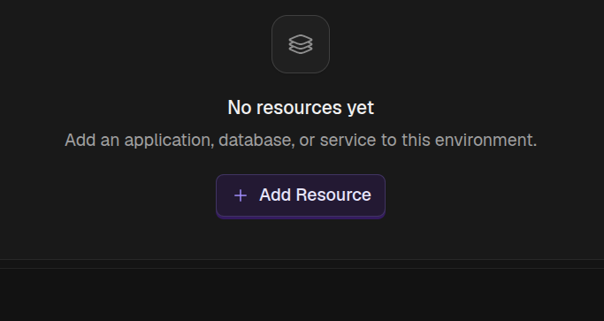
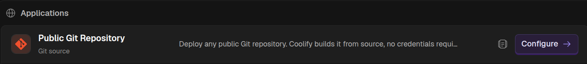
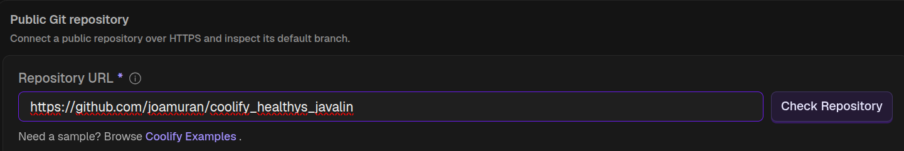
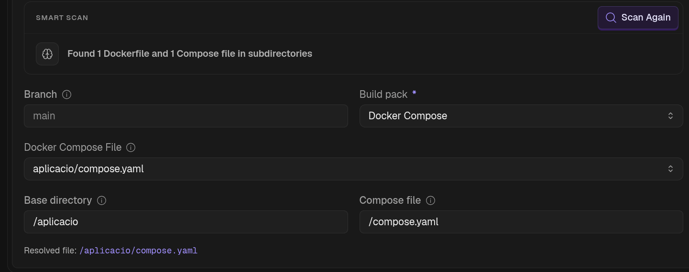
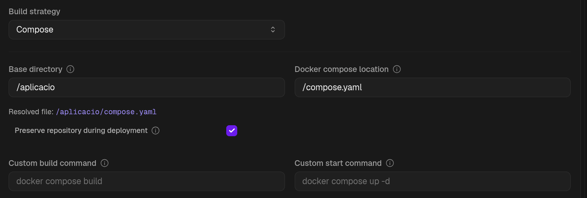
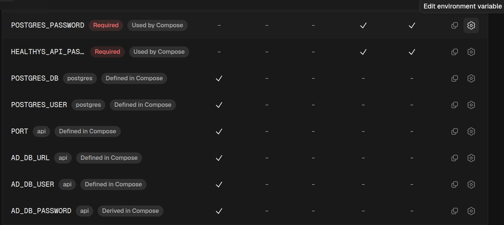
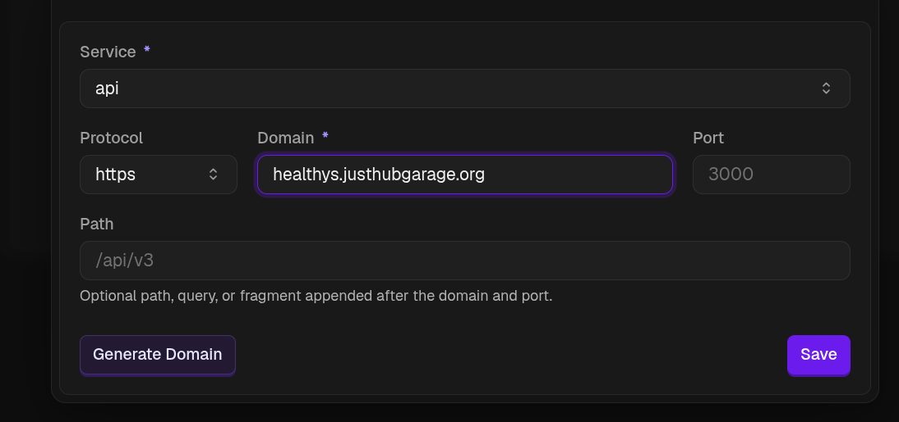
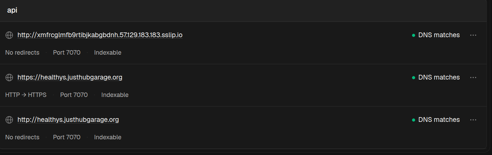

# Despleguem Healthy’s en Coolify des d’un subdirectori

Seguim la mateixa idea que en el desplegament web anterior: repositori Git, projecte, entorn i recurs. Ara el recurs és un conjunt Compose amb una API i PostgreSQL; no un lloc estàtic. Primer comprovem [l’execució local](LOCAL.md) i després registrem els passos reals del desplegament.

## Local i núvol: què canvia?

| Aspecte | Local | Coolify |
| --- | --- | --- |
| Compose | `compose.yaml` + `compose.local.yaml`. | Només `compose.yaml`. |
| Entrada HTTP | Port loopback 18085. | Domini HTTPS gestionat pel proxy de Coolify, dirigit al servei `api` i port intern 7070. |
| Credencials | `aplicacio/.env`, exclòs de Git. | Variables del recurs en el panell; no es puja `.env`. |
| PostgreSQL | Xarxa interna de Compose. | Xarxa interna del recurs; no publiquem un port de BD al VPS. |
| Dades | Volum local persistent. | Volum persistent del servidor; l’operació i les còpies són responsabilitat nostra. |

Amb la configuració actual no necessitem modificar el Dockerfile ni els fitxers Compose per passar a Coolify. En local combinem la base amb el complement, com expliquem en [la guia local](LOCAL.md#configuració-base-i-complement-local); en Coolify seleccionem únicament `compose.yaml`. El complement local publica un port en el nostre ordinador, mentre que en Coolify el proxy proporciona l'accés públic al port intern 7070. Configurarem en el panell les variables, les rutes del repositori i el domini que indiquem a continuació.

En tots dos casos despleguem els serveis: en local ho fem en el nostre ordinador i en Coolify en el servidor. La ruta `aplicacio/` és un directori del repositori, no el prefix de la URL pública. Les peticions continuaran sent `/api/entrants`, no `/aplicacio/api/entrants`.

## 1. Connectem el repositori

Accedim al [servei de Coolify](http://coolify.justhubgarage.org/) amb l'usuari i la contrasenya proporcionats pel professor. Abans de continuar, comprovem que hem pujat a GitHub els canvis que volem desplegar: Coolify descarrega el repositori remot, no els fitxers del nostre ordinador.

1. En **Projects**, creem un projecte o obrim el que ens corresponga.
2. Entrem en un entorn del projecte, per exemple **production**, i seleccionem **+ New** o **Add Resource**, segons la versió del panell.



3. Triem l'origen del codi. Si el repositori és públic, seleccionem **Public Repository** i introduïm la seua URL (per exemple, aquest mateix: `https://github.com/joamuran/coolify_healthys_javalin`). No necessitem vincular el compte de GitHub per clonar un repositori públic. Si és privat, utilitzem la connexió **GitHub App** o una **Deploy Key** amb accés de lectura prèviament configurada.




4. Comprovem el repositori i la branca que conté l'exemple. Si el panell ens demana servidor o destinació, seleccionem els que ens haja indicat el professor.
5. En la configuració de construcció de l'aplicació, seleccionem **Docker Compose**. Si Coolify proposa una configuració automàtica, la revisem i establim les rutes de la taula següent abans de desplegar.



Així distingim dues decisions: **d'on obtenim el codi** (repositori Git públic o privat) i **com el construïm i executem** (Docker Compose). No triem un servei predefinit de PostgreSQL ni enganxem un Compose buit: volem construir l'API i arrancar la base a partir dels fitxers del repositori. Podem consultar el [flux oficial per a repositoris públics](https://coolify.io/docs/applications/sources/public-repositories).

Configurem les rutes:

| Camp | Valor del nostre exemple |
| --- | --- |
| Base Directory | `/aplicacio` |
| Docker Compose Location | `/compose.yaml` —ruta relativa a aquella base; el format visual pot variar segons la versió. |
| Context de construcció API | `./api`, resolt des d'`aplicacio/`. |

Guardem i comprovem que Coolify ha llegit **els serveis `postgres` i `api`**. El Dockerfile es troba en `aplicacio/api/`, no en l'arrel del repositori. Amb la base correcta, també es resol `./postgres/init`. No seleccionem mode Raw ni el complement local. La documentació oficial explica com es combinen base i ubicació del Compose. [Docker Compose en Coolify](https://coolify.io/docs/applications/builds/docker-compose).

### Conservem els scripts del repositori

**Abans del primer Deploy**, activem **Preserve repository during deployment** en la configuració de construcció. Aquesta opció és necessària en aquest exemple perquè muntem `./postgres/init` del repositori en `/docker-entrypoint-initdb.d` del contenidor PostgreSQL. La construcció de la imatge Java pot funcionar encara que aquests fitxers no estiguen disponibles després per al muntatge.



La captura inicial mostra la selecció del Compose; aquesta segona completa la configuració que hem de deixar preparada abans de desplegar. Comprovem que el repositori remot conté `aplicacio/postgres/init/00-healthys.sql` i `01-permisos.sh`, i mantenim les rutes `/aplicacio` i `/compose.yaml`. Si el directori d'inicialització arriba buit al contenidor, PostgreSQL pot arrancar sense crear les taules ni el rol `healthys_api`. [Muntatges i conservació del repositori en Coolify](https://coolify.io/docs/applications/builds/docker-compose).

## 2. Configurem variables i domini

En les variables del recurs establim `POSTGRES_PASSWORD` i `HEALTHYS_API_PASSWORD` amb valors diferents dels de prova local. Les dues són de temps d'execució, no arguments de construcció. L'API rep només la clau del rol de lectura; PostgreSQL rep també la d'administració per a la inicialització.



### Domini generat: suficient per a l'activitat

No necessitem comprar ni disposar d'un domini propi. En **Domains**, afegim un domini al servei **api** i utilitzem **Generate Domain**. Comprovem el **port intern 7070**, deixem **Path** buit i guardem. Coolify genera una adreça segons la configuració de la instància; en el nostre exemple utilitza el servei [`sslip.io`](https://nip.io/). Conservem el protocol que estiga preparat en el servidor: generar el nom no garanteix per si mateix que HTTPS ja estiga disponible.



En aquesta captura s'estava introduint un domini propi. El `3000` del camp Port i el `/api/v3` del camp Path són només textos d'ajuda (*placeholders*), no valors introduïts. **Comprovem que el domini apunta al servei `api` i al port intern 7070**: si Coolify ja l'ha detectat, no cal escriure'l manualment; si no, l'indiquem en el camp Port. El Compose declara aquest port amb `expose: ["7070"]`. Deixem Path buit, perquè les rutes `/api/entrants`, `/api/principals` i `/api/begudes` ja estan definides en l'aplicació.

### Domini propi: alternativa opcional

Si disposem d'un domini, podem afegir un registre DNS **A** per al subdomini escollit que apunte a la IP pública del servidor. En el nostre cas hem configurat `healthys.justhubgarage.org` en OVH; el proveïdor pot ser qualsevol altre. Després l'afegim en Coolify al servei **api**, amb port intern **7070**, i configurem HTTPS i la redirecció HTTP → HTTPS quan el DNS i el proxy estiguen preparats. No necessitem mantindre una entrada HTTP independent per al mateix nom si ja hem configurat la redirecció.



La captura mostra les adreces utilitzades durant les proves, inclosa una entrada HTTP addicional que no és necessària amb la redirecció. Per a l'activitat ens basta un domini generat. **DNS matches** indica que el nom resol a la IP esperada; no comprova que l'API ni la connexió JDBC funcionen.

El port **7070 és la destinació interna del proxy**, no un port que hàgem d'afegir al navegador. Si la interfície mostra `https://DOMINI_API:7070`, aquell sufix configura l'encaminament intern; accedim públicament a `https://DOMINI_API/api/entrants`. No assignem domini a PostgreSQL ni hi afegim `ports:` per exposar-lo al VPS. La ruta `/` no té una pàgina definida en aquesta API.

## 3. Despleguem i comprovem

Seleccionem Deploy i observem les fases: clonació, construcció Gradle, imatge final Java, inicialització PostgreSQL i salut dels dos serveis. Revisem logs de construcció i d'execució sense copiar secrets. Els primers scripts creen les dades només si el volum és buit.

Quan el servei estiga saludable, provem des de fora del servidor amb el domini real. En les ordres següents substituïm `https://DOMINI_API` per la URL base generada o pròpia, inclòs el protocol que hàgem configurat:

```bash
curl -i https://DOMINI_API/api/salut
curl -f https://DOMINI_API/api/entrants
curl -f https://DOMINI_API/api/principals
curl -f https://DOMINI_API/api/begudes
curl -I https://DOMINI_API/img/amanida_mediterrania.png
```

Comprovem 13 entrants, 12 principals i 8 begudes, les llistes, els camps opcionals i una imatge. Després canviem només la URL base del client Flutter per provar la integració; la resta de rutes i del JSON es manté. El healthcheck valida la lectura real de la base, no només que el procés Java estiga viu.

Si apareix «No Available Server», revisem salut i logs, servei destinatari del domini, port 7070 i escolta Java en `0.0.0.0`. Si PostgreSQL funciona però falla JDBC, comprovem la clau del rol de lectura i el volum existent; editar una variable no canvia automàticament la contrasenya ja guardada en la BD. Per als redeploys conservem el volum i comprovem que els recomptes es mantenen.

## 4. Diagnostiquem una inicialització incompleta

**Container Running** indica que el procés està en marxa; **Healthy** confirma que supera la comprovació de salut (el fet que es diga igual que el repositori de l'App és pura coincidència!!). En l'API, `/api/salut` també comprova l'autenticació JDBC i la lectura de `healthys.producte`. Si falla, el proxy pot mostrar «No Available Server» encara que Java continue executant-se.

Si els logs de l'API mostren `SQLState 28P01`, consultem també els de PostgreSQL. El detall `Role "healthys_api" does not exist` indica que falta el rol; no demostra que hàgem escrit malament la contrasenya. Pot passar si el primer desplegament ha inicialitzat el volum amb el directori de scripts buit.

En aquest cas activem **Preserve repository during deployment**, comprovem les rutes i el contingut del repositori, i fem **Redeploy**. En la terminal del contenidor **postgres**, comprovem:

```bash
ls -la /docker-entrypoint-initdb.d/
psql -U healthys_admin -d healthys -c "SELECT to_regclass('healthys.producte');"
```

Han d'aparéixer els dos scripts. En la consulta, una cel·la buida representa `NULL`: **la taula no existeix**. Si el directori continua buit, corregim el muntatge abans de continuar. Activar l'opció i redesplegar recupera els fitxers, però no repeteix els scripts sobre un volum ja inicialitzat.

Si falta la taula i la càrrega anterior no ha deixat altres taules de l'aplicació, executem el SQL corregit en la mateixa terminal. Aquesta ordre crea les taules i carrega el catàleg; no la repetim en una instal·lació ja poblada:

```bash
psql -U healthys_admin -d healthys -v ON_ERROR_STOP=1 -f /docker-entrypoint-initdb.d/00-healthys.sql
```

Si acaba sense errors i falta el rol `healthys_api`, executem el segon script. Si la taula ja existia i només faltava el rol, passem directament a aquest pas:

```bash
bash /docker-entrypoint-initdb.d/01-permisos.sh
```

Aquest script obté la contrasenya de `HEALTHYS_API_PASSWORD` del contenidor; no hem de mostrar-la ni copiar-la en l'ordre. Si alguna instrucció falla, ens aturem i revisem el missatge abans de continuar. Finalment comprovem:

```bash
psql -U healthys_admin -d healthys -c "SELECT count(*) FROM healthys.producte; SELECT rolname FROM pg_roles WHERE rolname = 'healthys_api';"
```

Esperem **33 productes** i una fila amb **healthys_api**. El healthcheck es repeteix automàticament i hauria de recuperar-se sense reconstruir l'API. Conservem el volum: aquesta recuperació no requereix eliminar les dades.

